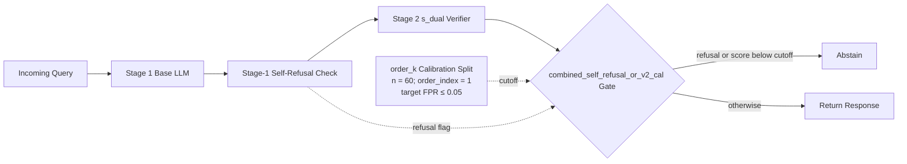

<h1 align="center">HRC-MVP</h1>

<p align="center"><strong>Generate answers. Audit premises. Calibrate the decision to abstain.</strong></p>

<p align="center">
  
  
  
  <a href="LICENSE"></a>
</p>

<p align="center">
  <a href="#the-problem">Problem</a> ·
  <a href="#system-architecture">Architecture</a> ·
  <a href="#benchmark-results-falseqa-n200">Results</a> ·
  <a href="#methodology">Methodology</a> ·
  <a href="#quickstart">Quickstart</a> ·
  <a href="#citation">Citation</a>
</p>

## The Problem

False-premise questions invite a model to answer as though an incorrect assumption were true. On the recorded FalseQA evaluation, native Stage-1 self-refusal misses **55%–65%** of false-premise questions across the three tested models. HRC-MVP decouples answer generation from a premise verifier and a calibrated risk decision, allowing a response to be withheld when either self-refusal or the verifier signals a problem.

## System Architecture

The diagram describes the **decoupled benchmark operating point**. Calibration is fitted separately before evaluation; both signals are measured for each evaluation item.



## Benchmark Results (FalseQA, n=200)

Recorded test-set results use 200 items (100 false-premise and 100 true-premise), CUDA with float16, and seed 42. Each run uses 60 calibration items, including 30 true-premise examples. AUROC and average precision measure discrimination using `-s_dual`; latency is the recorded mean per item. These results describe the recorded runs and are not hardware-independent speed claims.

| Model | Overall AUROC ↑ | Average precision ↑ | Overall self-refusal | False-premise self-refusal | Mean latency (ms/item) ↓ |
|:--|--:|--:|--:|--:|--:|
| [Qwen2.5-3B-Instruct](results/falseqa_n200/falseqa_qwen25_3b/summary.json) | 0.7059 | 0.6429 | 20.0% | 35.0% | 1309.88 |
| [Phi-3.5-mini-instruct](results/falseqa_n200/falseqa_phi35_mini/summary.json) | 0.8542 | 0.8733 | 27.0% | 45.0% | 2668.49 |
| [Qwen2.5-7B-Instruct](results/falseqa_n200/falseqa_qwen25_7b/summary.json) | 0.8976 | 0.8987 | 21.5% | 37.0% | 1766.09 |

**Key findings**

- **Capability scaling:** Qwen2.5-7B improves AUROC from 0.7059 to 0.8976 over Qwen2.5-3B in these runs.
- **Self-refusal ceiling:** only 35%–45% of false premises trigger native self-refusal, even when verifier discrimination is stronger.
- **Throughput trade-off:** Qwen2.5-7B is Pareto-optimal among these runs: it has the highest AUROC and lower recorded latency than Phi-3.5-mini; Qwen2.5-3B remains faster.

The calibration target applies to the Stage-2 cutoff, not a guarantee for the combined gate. On the test set, `stage2_v2_cal_only` false-positive rates are **12%, 2%, and 3%** respectively; `combined_self_refusal_or_v2_cal` rates are **17%, 11%, and 8%**. The target is an empirical calibration setting, not a guarantee of test-set or combined-gate FPR.

## Methodology

1. **Stage 1 — self-refusal:** [`_score_example`](scripts/bench_external.py) generates an answer via `HRCPipeline.query` and records `stage1_self_refusal` using `explicitly_rejects_premise`. This baseline is distinct from the Stage-1 `V_m` halt.
2. **Stage 2 — `s_dual`:** [`HRCPipeline._score_stage2`](hrc/pipeline.py) evaluates positive and negated premise prompts. It computes `s_dual = 0.5 * (d_pos - d_neg)` from yes/no logit differences; lower scores indicate greater false-premise risk.
3. **Calibration and gate:** [`_fit_order_k_cutoff`](scripts/bench_external.py) sorts true-premise (`label=0`) calibration scores and selects the zero-based `order_index = floor(max_fpr * n_cal_neg)`, bounded to the available indices. Here `n_cal_neg=30`, `max_fpr=0.05`, and `order_index=1`. The benchmark's `combined_self_refusal_or_v2_cal` flags an item when `stage1_self_refusal` is true **or** `s_dual < cutoff`. Calibration and evaluation questions are checked for overlap.

The standalone CLI uses the pipeline's `V_m` gate and `--stage2-cutoff` (default `0.0`); it does not automatically reproduce the benchmark's combined self-refusal operating point. See [`scripts/bench_external.py`](scripts/bench_external.py) for the latter and [`BENCHMARK_FINDINGS.md`](BENCHMARK_FINDINGS.md) for additional experiments.

## Repository Layout

```text
hrc-mvp/
├── hrc/                         # Installable pipeline and CLI
│   ├── __main__.py
│   ├── cli.py
│   └── pipeline.py
├── scripts/bench_external.py    # FalseQA and TruthfulQA benchmark runner
├── results/falseqa_n200/        # Per-model summaries, logs, and checkpoints
│   ├── falseqa_qwen25_3b/
│   ├── falseqa_phi35_mini/
│   └── falseqa_qwen25_7b/
├── tests/                       # Pipeline and external benchmark tests
├── bench_llm_hrc.py             # Core inference and scoring experiments
├── bench_arc_hrc.py             # ARC benchmark
├── bench_tofu_hrc.py            # TOFU benchmark
├── hrc_mvp.py                   # Original HRC prototype
├── layer3_entity_guard.py       # Entity-guarded memory helpers
├── pyproject.toml               # Package metadata and dependencies
├── requirements.txt             # Additional Colab-oriented dependencies
├── BENCHMARK_FINDINGS.md
└── COLAB_QUICKSTART.md
```

## Quickstart

Python **3.10+** is required. Model weights and, for the benchmark, FalseQA data are downloaded on first use; a CUDA GPU is recommended for the larger models. Install a PyTorch build suitable for your hardware first when needed.

```bash
git clone https://github.com/vinaypcv/hrc-mvp.git
cd hrc-mvp
python -m pip install -e ".[bench]"
python -m pip install -r requirements.txt

# Run the installed pipeline (downloads the model on first use).
python -m hrc --model Qwen/Qwen2.5-0.5B-Instruct --query "What is the capital of France?" --stage2-mode dual --json
```

Run the external benchmark with an independent 60-item calibration split and 200 evaluation items:

```bash
python scripts/bench_external.py --dataset falseqa --model Qwen/Qwen2.5-3B-Instruct --device cuda --dtype float16 --cal-size 60 --limit 200 --seed 42 --max-false-halt-rate 0.05 --out-dir results/my_falseqa_run
```

Use `--resume` to continue a matching checkpoint, or `--falseqa-dir PATH` to supply local `valid.csv` (or `train.csv`) and `test.csv`. See `python scripts/bench_external.py --help` and the [Colab quickstart](COLAB_QUICKSTART.md) for more options.

Inspect the committed summaries without loading a model:

```bash
python -c "import glob,json; [(lambda d: print(d['model'], d['discrimination'], d['stage1_self_refusal_baseline'], d['mean_latency_ms']))(json.load(open(p, encoding='utf-8'))) for p in sorted(glob.glob('results/falseqa_n200/*/summary.json'))]"
```

## Roadmap

- Expand evaluation across datasets, model families, and random seeds.
- Study calibration stability and combined-gate false-positive control on larger independent splits.
- Measure latency and throughput under reproducible hardware and batching configurations.
- Improve verifier, calibration, and deployment interfaces based on observed failure modes.

## Citation

```bibtex
@software{vinaypcv2026hrcmvp,
  author = {Vinay},
  title  = {HRC-MVP: Calibrated Risk Control for False-Premise Questions},
  year   = {2026},
  url    = {https://github.com/vinaypcv/hrc-mvp}
}
```

## License

This project is licensed under the [MIT License](LICENSE).
